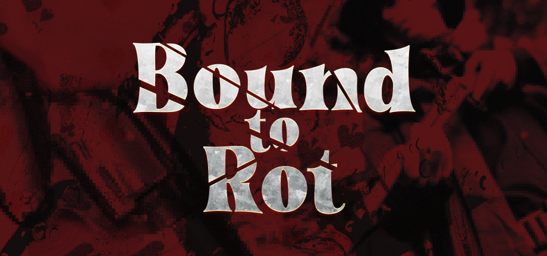

*A Diablo 2-style isometric action RPG, written in Python.*

_[Contributing](CONTRIBUTING.md)_  
_[Third-Party Assets](THIRD_PARTY_ASSETS.md)_  

_Started May 10, 2026. Open-sourced October 14, 2026._

## Contributing

See [CONTRIBUTING](CONTRIBUTING.md) for general code style, AI and PR guidelines, including the lore rule.

If you'd like to report a bug or suggest a feature, open an [issue](https://github.com/MangasMango/bound-to-rot/issues). Keep your own agent notes, prompts and plans in `.ai/`; it is gitignored, so each contributor's notes stay local.

## Gameplay

- **Anima** | an endless isometric descent. Depth drives everything: monster level, item level and reward quality.
- **The Pulse** | your mobile light anchor. Leave its light radius and darkness starts eating you alive. Clear a wave and the Pulse opens the **chart**: pick your next checkpoint, claim a 1-of-3 relic boon.
- **Vessels** | Pyrrhian (knight) from the start; Myronian (warrior) at Depth 10, Theran (fighter) at Depth 20, unlocked account-wide.
- **Permadeath** | dying in the Anima deletes the character. Only your account-wide best depth survives.
- **Items & Tarot** | gear drops unidentified and is revealed with tarot cards, which double as crafting currency (upgrade, force mythic, reroll). Gems socketed into **Q / W / E / R** grant abilities; a **T** flask gives one charge per wave.

### Controls

| Key | Action |
|-----|--------|
| Right Click (press/hold) | Move |
| Left Click | Attack enemy / interact / ground loot / click the Pulse |
| `Q` `W` `E` `R` | Cast socketed gem abilities |
| `T` | Drink flask (1 charge per wave) |
| `I` | Toggle inventory |
| `C` | Character stats panel |
| `Tab` | Delve chart / minimap overlay (in Anima) |
| `Escape` | Pause |
| `` ` `` | Dev console (type `help` for commands) |

## Building

If you'd rather compile on your own, follow these instructions.
First, make sure you have [Python 3.12+](https://www.python.org/downloads/) installed; **older versions will not work.** Open a terminal in the project directory, install the dependencies with `uv sync` (or `pip install .`), then run the following commands.

### Windows

_Running:_ `python main.py`  
_Tests:_ `python -m pytest tests/ -q`  
_Building:_ `pyinstaller main.spec`

### Linux/Mac OS

_Running:_ `python3 main.py`  
_Tests:_ `python3 -m pytest tests/ -q`  
_Building:_ `pyinstaller main.spec`

### Assets

Game assets live in `assets/` and **not all of them are in this repository**; see [`THIRD_PARTY_ASSETS.md`](THIRD_PARTY_ASSETS.md). The `boss`, `environment`, `enemy`, `none-playable character`, `playable character`, `prop` and `user interface` folders come from a third-party pack that forbids redistribution; obtain the pack yourself and copy the files into those folders before running the game.

The game detects missing packs at boot: it prints a console notice, shows a dismissible banner in the menus, and renders affected entities as colored placeholder silhouettes so it stays runnable without them.

The assets are collected on [itch.io](https://itch.io/c/8322662/boundtorot). If you can't find something, or you have questions about a licence, contact me on [Discord](https://discord.com/invite/s2rgHuctdc) or by [email](mailto:mangasmangostudios@gmail.com).

### Troubleshooting

#### Permission Denied

If the terminal returns `Permission denied` or `Command not found` on Mac/Linux when running `python3`, make sure Python 3.12+ is actually installed (`python3 --version`).

## Downloads

[Bound to Rot on Steam](https://store.steampowered.com/app/4840980/Bound_to_Rot/)

## Support

If you want to support development, you can sponsor me on [GitHub Sponsors](https://github.com/sponsors/MangasMango) or [buy me a coffee on Ko-fi](https://ko-fi.com/mangasmango).

## License

Source code: [GNU General Public License v3.0 or later](LICENSE).

Game assets are **not** covered by the GPL; they stay under their original licences, see [`THIRD_PARTY_ASSETS.md`](THIRD_PARTY_ASSETS.md).
